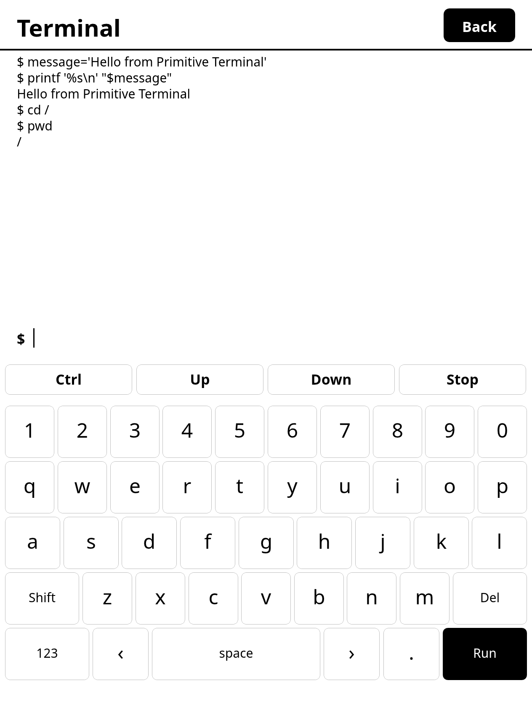

# Primitive Terminal

**Run shell commands on Kindle**

  

[**Download**](https://github.com/PrimitiveOS/kindle-primitive-terminal/releases/latest) · [**Install guide**](INSTALL.md) · [**Changelog**](CHANGELOG.md)

---

Type a shell command on the on-screen keyboard and read its output. Primitive Terminal opens from the Kindle library and can also run from Primitive Launcher.

## Quick start

After setting up PrimitiveOS, open **Store** from Primitive Launcher. Choose **Primitive Terminal** under **Apps**,
tap **Get**, and open it from the Launcher grid. The [install guide](INSTALL.md) also covers the standalone USB package.

## Screenshots

<table>
  <tr>
    <td align="center"> Type a command</td>
    <td align="center"> Read the result</td>
    <td align="center"> Keep working in the same session</td>
  </tr>
</table>

Captured from the macOS desktop build with sample shell commands.

## Highlights

- **One shell per session.** Working directory and shell variables carry over between commands. Output appears as
  the command runs. Tap **Stop** to send Ctrl-C.
- **On-screen keyboard.** Use the shared PrimitiveOS keyboard with Shift, symbols, Del, Run, and a Ctrl key.
- **Scroll through output.** Swipe down for older lines and swipe up to move toward the latest output.
- **Return to the library.** Tap **Back** or use the back page button to exit.

## Status

| Device | Status |
|---|---|
| Kindle Oasis 3 (1264 × 1680, firmware 5.18.2) | Tested on hardware |

**Current version: 0.1.9.** Changes are in [CHANGELOG.md](CHANGELOG.md).

## Downloads

**39 downloads** from Store, as of 2026-11-21. Store shows the same count on the app page.
The count is GitHub downloads of this app's release packages, from the [Store catalog](https://primitiveos.github.io/kindle-primitive-catalog/v1/index.json).

## Documentation

[Install guide](INSTALL.md) · [Changelog](CHANGELOG.md)

## Licence

- **Code** is licensed under GNU AGPL-3.0-only. The shell engine is ported from the KOReader terminal plugin,
  copyright the KOReader contributors. The e-ink and input code comes from the AGPL versions of Primitive
  Launcher and Primitive Browser. [Software licence](LICENSE) · [Engine attribution](crates/kt-engine/src/lib.rs)
- **Original documentation and pictures**, including this README and its screenshots, are copyright (C) 2026
  Doan Nguyen and licensed under CC BY-NC-SA 4.0. [Documentation and pictures licence](LICENSE-DOCS)
- **Fonts** use the SIL Open Font License. [Noto Sans licence](assets/fonts/NOTO-LICENSE.txt)
