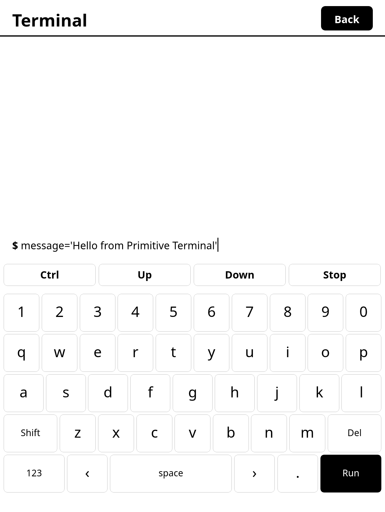
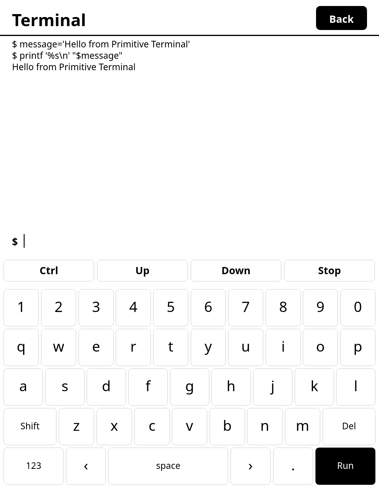

<div align="center">


# Primitive Terminal

**A shell for jailbroken Kindle e-readers.**

[**Install guide**](INSTALL.md) · [**Changelog**](CHANGELOG.md) · [**Licence**](#licence)

</div>

---

Type a shell command on the on-screen keyboard and read its output on the Kindle's grayscale display.
Terminal opens from the Kindle library or the Primitive Launcher grid.

## Screenshots

<table>
  <tr>
    <td align="center"><br><sub>Type a command</sub></td>
    <td align="center"><br><sub>Read the result</sub></td>
    <td align="center"><br><sub>Keep working in the same session</sub></td>
  </tr>
</table>

<sub>Captured from the macOS desktop build with sample shell commands.</sub>

## Highlights

- **One shell per session.** Working directory and shell variables carry over between commands. Output appears as
  the command runs. Tap **Stop** to send Ctrl-C.
- **On-screen keyboard.** Use the shared Primitive keyboard with Shift, symbols, Del, Run, and a Ctrl key.
- **Scroll through output.** Swipe down for older lines and swipe up to move toward the latest output.
- **Return to the library.** Tap **Back** or use the back page button to exit.

## Quick start

On a jailbroken Kindle with library script support, unpack the USB package and merge its `terminal/` and
`documents/` folders onto your Kindle drive. Open **Terminal** from the library or Launcher grid.
[Install guide](INSTALL.md)

## Status

The ARMHF and ARMEL candidates passed the Mac package checks. See the install guide for the Oasis 3 setup
and the available installation paths.

<details>
<summary><b>Build and test from source</b></summary>

```sh
git submodule update --init --recursive
cargo test --locked --workspace
cargo zigbuild --locked --release -p kt-kindle --target armv7-unknown-linux-musleabihf
printf 'type echo Hello\ngo\nwait 400\nshot hello\nquit\n' | cargo run --locked -p kt-desktop -- --out out
```

`kt-engine` runs the shell through a pseudo-terminal. `kt-core` handles input, output, and scrolling, and
`kt-render` draws those states with parley and vello_cpu. `kt-kindle` runs on the device and `kt-desktop`
captures PNGs from the desktop build. The library entry and SSH installer live in `deploy/`, with packaging in
`scripts/` and shared components in `tools/`.

</details>

## Licence

- **Code** is licensed under GNU AGPL-3.0-only. The shell engine is ported from the KOReader terminal plugin,
  copyright the KOReader contributors. The e-ink and input code comes from the AGPL versions of Primitive
  Launcher and Primitive Browser. [Software licence](LICENSE) · [Engine attribution](crates/kt-engine/src/lib.rs)
- **Original documentation and pictures**, including this README and its screenshots, are copyright (C) 2026
  Doan Nguyen and licensed under CC BY-NC-SA 4.0. [Documentation and pictures licence](LICENSE-DOCS)
- **Fonts** use the SIL Open Font License. [Noto Sans licence](assets/fonts/NOTO-LICENSE.txt)
